# SR-MPLS Learning Journey

A 22-day video course on **Segment Routing over the MPLS data plane**, taking a
network engineer from *why Segment Routing exists* through to designing,
migrating and troubleshooting a production SR core.

Created and presented by **Enam Ahmed** — [The Packet Path With Partha](https://www.youtube.com/@ThePacketPathWithPartha).

> **Watch on YouTube.** GitHub does not stream video — the files in `videos/`
> download rather than play. The YouTube links below are the intended way to
> watch, and include chapters, captions and the full descriptions.

📺 **[Full playlist →](https://www.youtube.com/playlist?list=PLYQHPRJxy5xk)**
🔔 **[Subscribe →](https://www.youtube.com/@ThePacketPathWithPartha?sub_confirmation=1)**
📘 **[Facebook page →](https://www.facebook.com/ThePacketPathWithPartha)**

---

## Episodes

### Day 1 — Why Segment Routing?
*From protocol complexity to source-routed simplicity*

Why Segment Routing simplifies the MPLS control plane. Contrasts traditional
MPLS using an IGP with LDP and RSVP-TE against the SR-MPLS source-routing
model, and introduces Segment Identifiers, Prefix-SIDs, Adjacency-SIDs, the
head-end concept, and the unchanged MPLS data plane.

▶ [Watch on YouTube](https://www.youtube.com/watch?v=eDqwu6q8Vrc) · 15:22 ·
[`videos/Day01_Why_Segment_Routing.mp4`](videos/Day01_Why_Segment_Routing.mp4)

---

### Day 2 — What Is the SRGB?
*SID index, label arithmetic, and the block every router reserves*

The Segment Routing Global Block, and the arithmetic behind every SR label:

```
label = SRGB base + SID index
16000  +  2       = 16002
```

Covers why LDP's locally-significant labels carry no meaning beyond one link,
the critical distinction between the **globally significant SID index** and the
**locally computed label**, and a walkthrough where one router deliberately uses
a different SRGB base — showing why forwarding still works.

▶ [Watch on YouTube](https://youtu.be/1CZ7QkoUPV0) · 12:24 ·
[`videos/Day02_What_Is_the_SRGB.mp4`](videos/Day02_What_Is_the_SRGB.mp4)

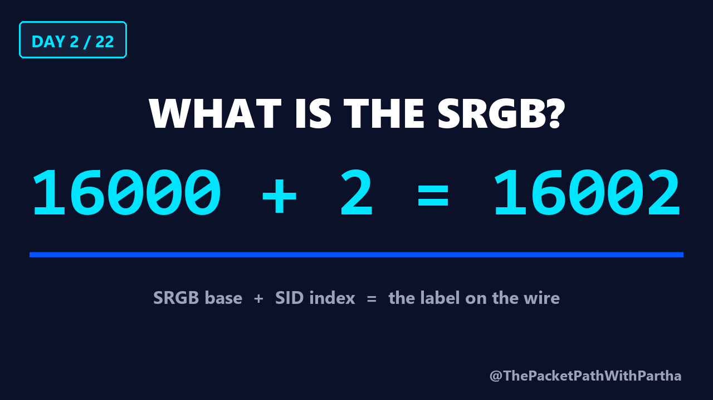

---

### Day 3 — How SIDs Travel
*The IS-IS and OSPF extensions that carry Segment Routing*

How SR capability and SIDs are flooded by the IGP — and why neither IS-IS nor
OSPF needed a redesign to carry them.

**IS-IS carriers**
| Carrier | Sub-TLV |
|---|---|
| Router Capability TLV 242 | SR Capability sub-TLV 2 (the SRGB) |
| Extended IP Reachability TLV 135 | Prefix-SID sub-TLV 3 |
| Extended IS Reachability TLV 22 | Adjacency-SID sub-TLV 31 |
| SID/Label Binding TLV 149 | used by the Mapping Server |

**OSPF carriers**
| Carrier | Contents |
|---|---|
| Router Information Opaque LSA | SR-Algorithm TLV 8, SID/Label Range TLV 9 |
| Extended Prefix Opaque LSA (type 7) | Prefix-SID sub-TLV 2 |
| Extended Link Opaque LSA (type 8) | Adjacency-SID sub-TLV 2 |

▶ [Watch on YouTube](https://youtu.be/FA196yiaYzo) · 12:40 ·
[`videos/Day03_How_Do_SIDs_Travel.mp4`](videos/Day03_How_Do_SIDs_Travel.mp4)

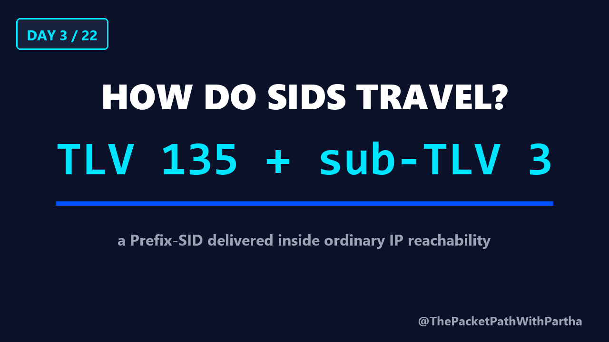

---

### Day 4 — The SID Family
*Prefix, Node, Adjacency and Anycast — what each one instructs*

Four names used almost interchangeably in conversation, and each encoded
differently. A **Prefix-SID** is globally significant and travels as an SRGB
index; an **Adjacency-SID** is locally significant, travels as an absolute
label, and is allocated automatically when an adjacency comes up.

Covers the flag bits with their real IOS XR defaults — **N** (Node-SID, set by
default), **P / NP** (no-PHP), **E** (Explicit-Null, so MPLS EXP/TC bits survive
the final hop) — and how OSPF's different bit layout maps one-to-one onto
IS-IS's.

Closes on the **Anycast-SID**: two routers advertising the same SID on purpose,
giving coarse traffic engineering and automatic failover with no policy change.
The requirement — every node sharing it must use the same SRGB.

▶ [Watch on YouTube](https://youtu.be/NwdrLDNd-60) · 13:26 ·
[`videos/Day04_The_SID_Family.mp4`](videos/Day04_The_SID_Family.mp4)

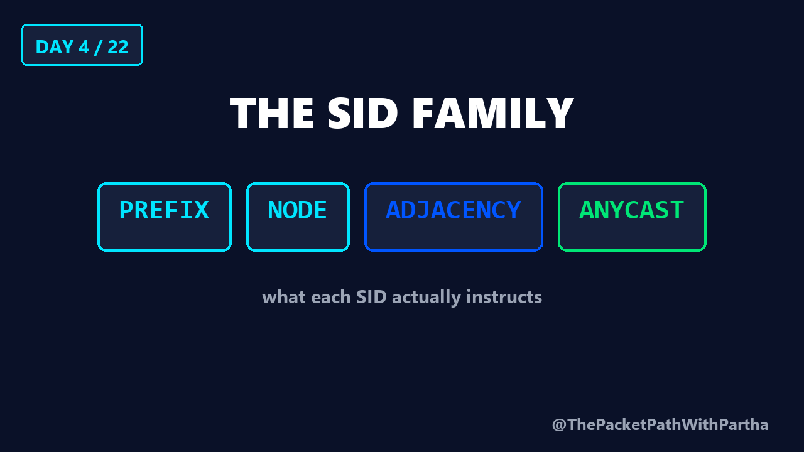

---

### Day 5 — Reading the Label Stack
*From an intent to an ordered list of instructions*

A single Node-SID gets you the shortest path and nothing more. To control where
traffic actually goes — avoid a link, force a region, guarantee a property — you
need a list of SIDs. This episode builds one, then reads one back off a
captured packet.

The rule behind all of it: **only the top label in a stack is ever active.**
Everything below waits its turn and is popped into place one hop at a time.

```
PE1 must reach PE2 while avoiding P1:

  16002   →  get to P2 (the detour that dodges P1)
  16004   →  then shortest path to PE2
```

Two labels, no per-hop state in the core, nothing signalled. Run in reverse,
a captured stack decodes straight back into the path it encodes — subtract the
SRGB base, and the indexes name the hops. Closes on **Maximum SID Depth**, the
hardware ceiling on how many labels a platform can impose.

▶ [Watch on YouTube](https://youtu.be/wbZUE7HYyp8) · 11:25 ·
[`videos/Day05_Reading_the_Label_Stack.mp4`](videos/Day05_Reading_the_Label_Stack.mp4)

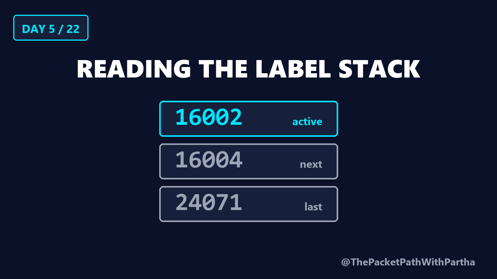

---

### Day 6 — The SR Forwarding Plane
*LFIB, penultimate hop popping, and Explicit Null*

Five days of control-plane theory, and here is the reassuring part: almost
none of it touches the forwarding plane. SR was deliberately designed to leave
the LFIB — and the push/swap/pop every MPLS router already does — alone.

One label, traced end to end. Node4 advertises `1.1.1.4/32` with Prefix-SID
16004, requesting default behaviour:

```
PUSH   at the ingress router
SWAP   at each transit router
POP    at the penultimate hop   (PHP)
```

The packet reaches Node4 as plain IP, with no MPLS lookup at the egress router
at all.

**The trade-off.** PHP saves that lookup, but the label carrying the MPLS
EXP/TC bits is gone before the packet arrives. For a pipe-model QoS design
that depends on those bits surviving the last hop, the **E-flag** requests
Explicit-Null instead — the penultimate hop *swaps* rather than pops, so the
packet arrives still labelled and the marking is intact. One lookup saved
versus QoS bits preserved, and it is worth deciding on purpose.

▶ [Watch on YouTube](https://youtu.be/0Tl8j2QTWUM) · 12:21 ·
[`videos/Day06_The_SR_Forwarding_Plane.mp4`](videos/Day06_The_SR_Forwarding_Plane.mp4)

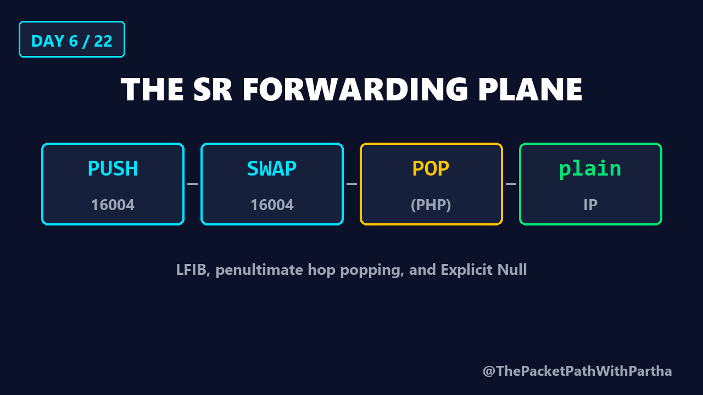

---

### Day 7 — Configuring SR with IS-IS
*From zero to a verified SR-enabled IS-IS core*

Six days of theory, now turned into a configuration you could type into a
router. The whole surface is smaller than you'd expect: one address-family
command (`segment-routing mpls`), one index per loopback (`prefix-sid
index`), and one global-block declaration for the SRGB. Most of an IS-IS
network — adjacencies, loopbacks, reachability — is already there; this is
the small delta on top of it.

Three commands verify three different layers: `show isis segment-routing
label table` proves the labels were computed, `show mpls forwarding` proves
the LFIB actually programmed them, `show isis database verbose` proves what
got advertised in the first place. Closes on four real places this breaks —
forgetting `metric-style wide`, a non-passive loopback, a duplicate
Prefix-SID index, and a mismatched SRGB.

*Sourcing note: no IS-IS lab capture exists in this project's source
material — every config available is OSPF-based. The CLI shown is standard,
well-documented IOS XR syntax for teaching, not a captured lab output.*

▶ [Watch on YouTube](https://youtu.be/9B0sjZa6Ono) · 11:39 ·
[`videos/Day07_Configuring_SR_with_IS-IS.mp4`](videos/Day07_Configuring_SR_with_IS-IS.mp4)

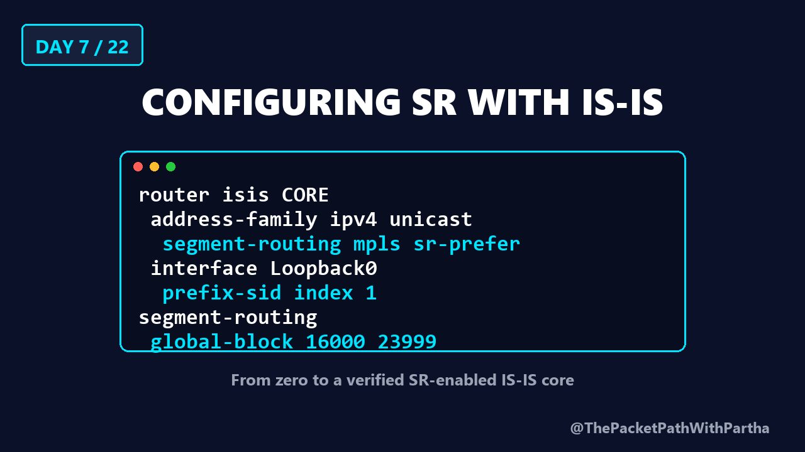

---

### Day 8 — Configuring SR with OSPF
*The same model, carried by a different IGP*

Yesterday: Segment Routing on IS-IS. Today: OSPF — and the interesting part
isn't how different it is, it's how little changes. Unlike Day 7, this episode
is built entirely on a **real four-router IOS XR lab**: R1–R4 in a line, one
OSPF area, the default SRGB on every router, Prefix-SID indexes 1–4.

Three things OSPF does differently from IS-IS, and everything else is
identical:

- **No `metric-style wide`.** SR rides in Opaque LSAs that already existed.
- **Forwarding is a separate command.** `segment-routing mpls` advertises;
  `segment-routing forwarding mpls` installs what arrives. Miss the second and
  the database looks perfect while nothing forwards.
- **The Prefix-SID lives under the interface, inside the area block.**

The proof, straight from the lab — a traceroute from R1 to R4 shows the **same
label, 16004, at every hop**. Every router computed it from the same SRGB and
the same index. All of it travels in one LSA, Type 10 (the area-scoped
Opaque): the index is advertised, the label is computed locally.

▶ [Watch on YouTube](https://youtu.be/Ugb3zzkQiL8) · 16:59 ·
[`videos/Day08_Configuring_SR_with_OSPF.mp4`](videos/Day08_Configuring_SR_with_OSPF.mp4)

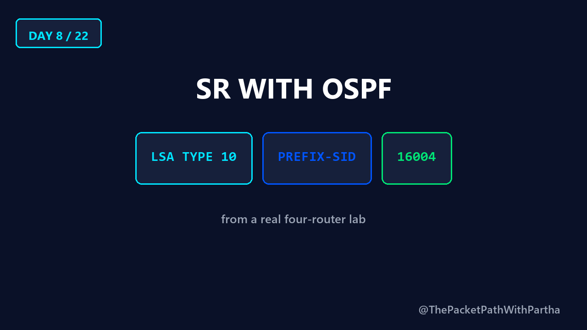

---

### Day 9 — The SR Mapping Server
*Giving SIDs to routers that never asked for one*

For two days Prefix-SIDs were configured the obvious way: log in to the router,
type an index. Today, the two cases where that stops working — **scale**
(a thousand routers, a thousand change windows, one typo is a duplicate SID)
and **routers that cannot advertise a Prefix-SID at all** (old platforms,
regions still on LDP). Both have one answer: the **Mapping Server**.

The lab is a **real five-router IOS XR capture** across three OSPF areas, with a
different SRGB on every router (default, 20000, 30000, 40000, 50000) — on
purpose, to prove the Mapping Server advertises an *index*, never a label.

- **One line, one router:** `1.1.1.1/32 1 range 100` — a hundred Prefix-SIDs.
- **On the wire:** an Extended Prefix Range TLV in Opaque Type 7 — Range Size
  is what scales.
- **Crossing an area:** the ABR re-originates it and sets the **IA-flag**
  (0x0 → 0x80), which stops redundant ABRs looping the advertisement.
- **The proof:** XRV5's traceroute to 1.1.1.1 uses labels 40001, 30001, 20001 —
  one destination, four different labels, one unchanging index.

▶ [Watch on YouTube](https://youtu.be/9x-Cf7Zi5GU) · 16:28 ·
[`videos/Day09_The_SR_Mapping_Server.mp4`](videos/Day09_The_SR_Mapping_Server.mp4)

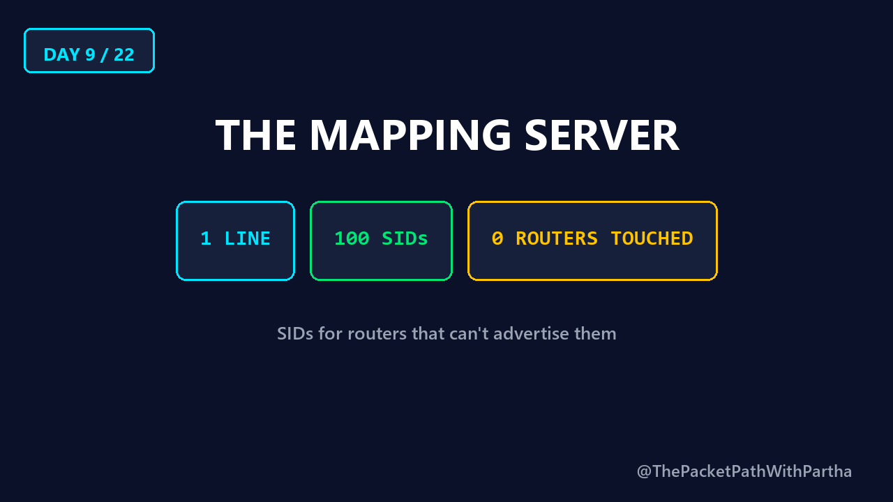

---

### Day 10 — Migrating LDP to SR
*A brownfield core, and nobody notices*

Nobody gets a greenfield core. You inherit a network that has run LDP for years,
carries live services, and has to be modernised without anyone noticing. The
good news: this is one of the least dangerous migrations in networking, provided
the order is right.

- **Ships-in-the-night.** SR and LDP both produce MPLS labels and hand them to
  the same LFIB, so a router runs both indefinitely. Migration is a long,
  reversible coexistence, not a cutover.
- **One keyword:** `segment-routing mpls sr-prefer` — where both labels exist,
  use the SR one. It does *not* disable LDP or touch prefixes only LDP can
  reach; remove it and everything goes straight back.
- **Five phases:** enable SR and prefer nothing → verify in parallel → cover
  the gaps with a Mapping Server (Day 9) → switch preference one router at a
  time from the edge → retire LDP last.
- **The boundary** is an ordinary label swap in the shared LFIB; going LDP→SR
  needs a SID for the destination, which is why the Mapping Server phase comes
  before the preference switch.

Unlike Days 8 and 9 this episode is not built on a captured lab: the syntax is
standard IOS XR and the sequence is the widely published industry approach.

▶ [Watch on YouTube](https://youtu.be/luddzvojvuQ) · 15:41 ·
[`videos/Day10_Migrating_LDP_to_SR.mp4`](videos/Day10_Migrating_LDP_to_SR.mp4)

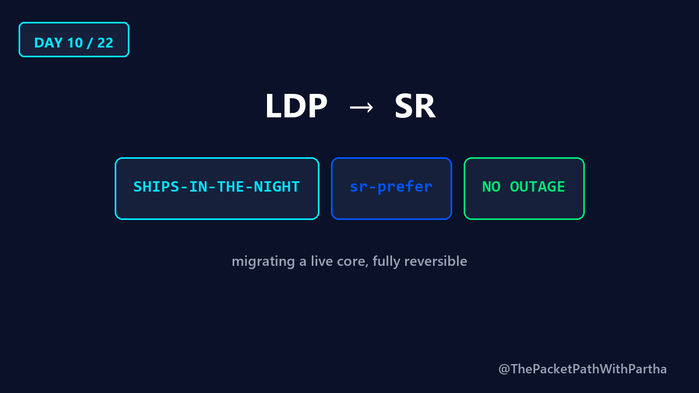

---

### Day 11 — SR-TE Fundamentals
*Policies, candidate paths, and preference*

Module 3 starts here. The first ten days were about reachability - the best path
the IGP could find. From today, the network is told to take a path it would not
have chosen, and the question is what that costs.

- **The old way charged for state.** RSVP-TE created state on every router a
  path crossed, signalled hop by hop, and a full mesh grew with the square of the
  edge routers - in the core.
- **SR-TE charges nothing in the core.** A path is a list of SIDs carried in the
  packet; the only router that knows a TE path exists is the one that imposed it.
- **An SR Policy is named by three things:** head-end, color and end-point.
- **Candidate paths** are explicit or dynamic, and exactly one is installed:
  a path is selected when it is **valid and has the highest preference among the
  valid ones** - preference 200 on an invalid path loses to 100 on a valid one.
- **The Binding-SID** is one label standing for the entire path: the real win is
  naming, so everything upstream keeps one stable label while the path underneath
  changes.

▶ [Watch on YouTube](https://youtu.be/b7ggirciTGs) · 16:41 ·
[`videos/Day11_SR_TE_Fundamentals.mp4`](videos/Day11_SR_TE_Fundamentals.mp4)

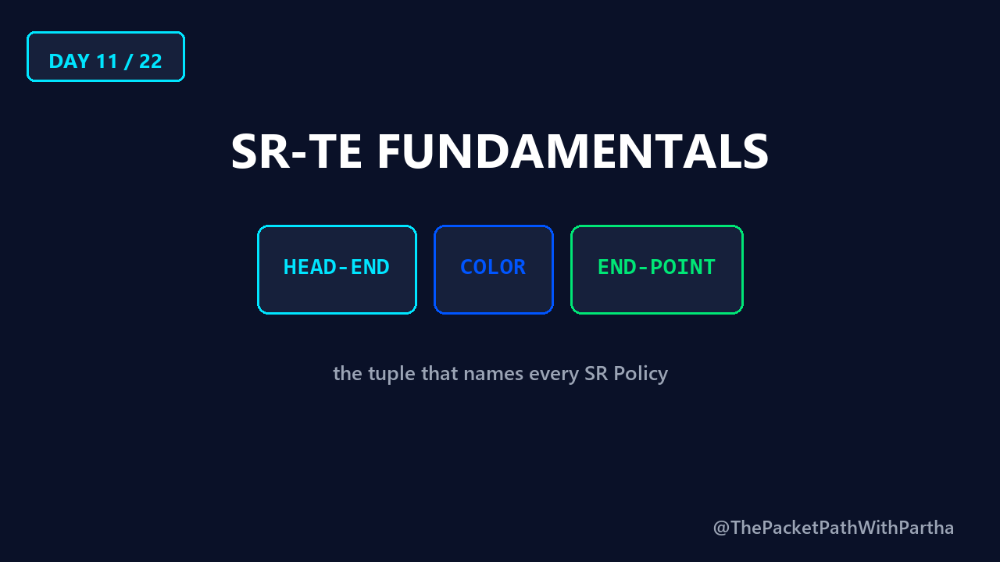

---

### Day 12 — Explicit Paths and SID-Lists
*Strict hops, loose hops, and pinning traffic to one link*

Day 11 gave the vocabulary of SR Policies. Today the first real candidate path is
built: the explicit one, where the SID-list is written by hand. A SID-list is
Day 5's label stack written as configuration - the head-end imposes it on every
packet, with no recomputation and no negotiation.

- **Strict hop:** the next SID must be exactly one IGP hop away. Every hop named,
  in order - for when the path *is* the requirement.
- **Loose hop:** the next SID only needs to be reachable by shortest path - for
  when only some waypoints matter. A single list can mix both.
- **Pinning one link:** two Prefix-SIDs reach P2 by shortest path, then one strict
  **Adjacency-SID** forces the exact next hop - an Adjacency-SID names a link,
  never a node.
- **What breaks a list:** a SID stops advertising, a strict hop is no longer
  adjacent, a pinned link goes down, a typo. All four give an **invalid SID-list**
  and no forwarding entry - never a silent fallback through the wrong path.

▶ [Watch on YouTube](https://youtu.be/1Tvoq5PzYkw) · 12:54 ·
[`videos/Day12_Explicit_Paths_and_SID_Lists.mp4`](videos/Day12_Explicit_Paths_and_SID_Lists.mp4)

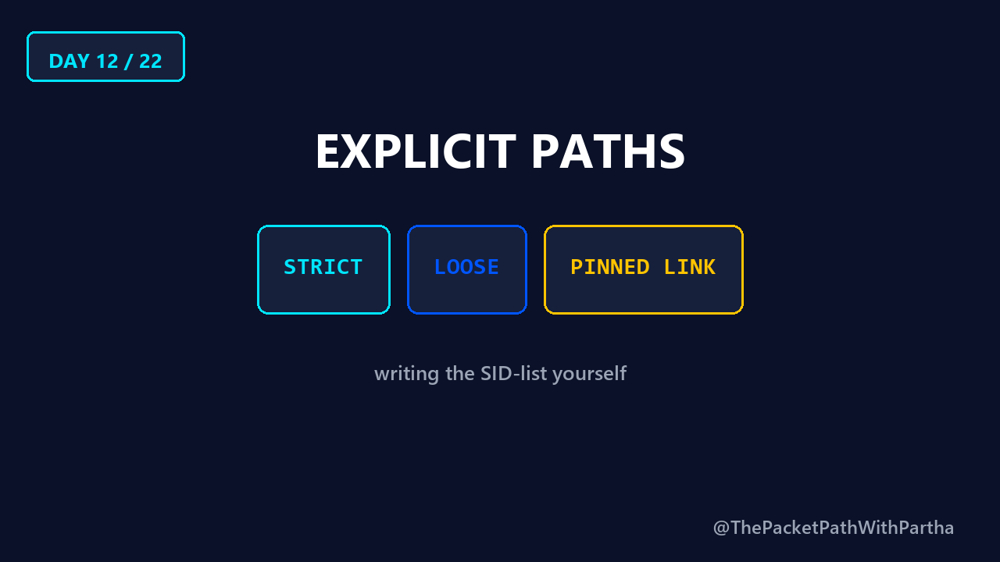

---

### Day 13 — Dynamic Paths
*Describe the objective, let the head-end compute the SID-list*

Day 12's explicit SID-list is yours to maintain forever as the topology moves.
Today the model flips: describe an objective and constraints, and the head-end
computes the SID-list itself - and recomputes it when the network changes.

- **Min-metric, with a margin.** The default objective is the shortest path by
  IGP metric, TE metric or measured delay. A margin accepts anything within a
  stated tolerance of the true shortest, so near-equal paths do not flap the
  policy - with a cap on SID-list length.
- **Five constraints:** TE affinity, IP address, SRLG, maximum metric, and limit
  SIDs (your MSD protection, built into the computation).
- **SRLG and disjointness.** An SRLG gives a shared physical risk a number so a
  path can avoid it entirely. Two paths in the same **disjoint-group** are
  guaranteed to share no link (or no node) - two paths that merely avoid each
  other's links are *not* automatically disjoint.

▶ [Watch on YouTube](https://youtu.be/Pa72YwgVVPs) · 12:29 ·
[`videos/Day13_Dynamic_Paths.mp4`](videos/Day13_Dynamic_Paths.mp4)

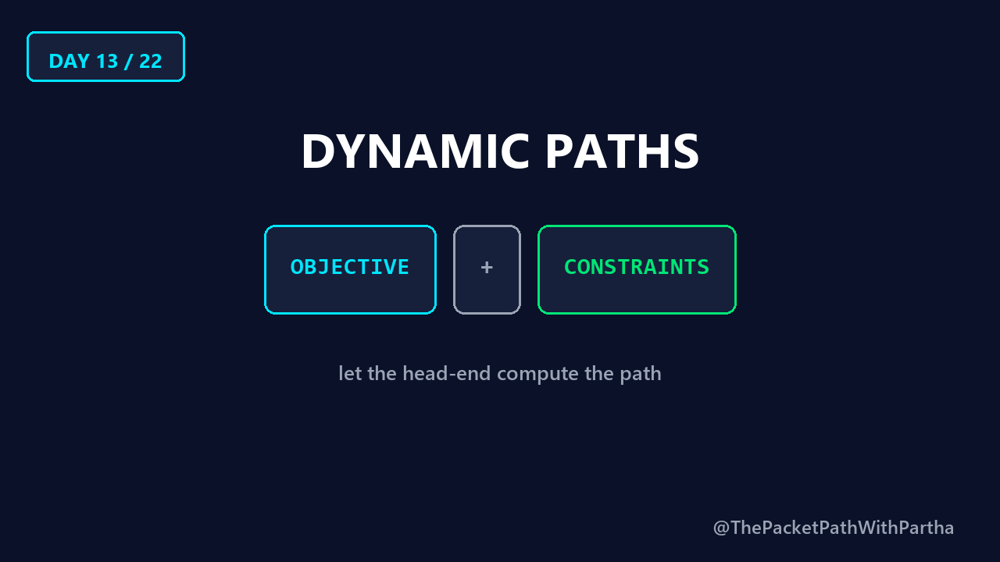

---

### Day 14 — Binding-SID and Path Stitching
*One label that outlives the path underneath it*

Day 11 mentioned the Binding-SID almost in passing. Today it gets the whole
session: a label that names a policy, not a path, is one of the most powerful
ideas in SR-TE.

- **A stable name.** Every candidate path of a policy shares one BSID, so
  services, static routes and other policies can steer by it while the path
  underneath is recomputed or replaced.
- **Two ways into a policy.** By colour and end-point (the ordinary case), or by
  pushing the BSID itself - no colour match, no end-point lookup. The label is
  the instruction.
- **Stitching across a domain boundary.** PE1 has no visibility into Domain B,
  so its SID-list is: reach the ABR, then push the ABR's own BSID. The ABR runs
  its own independently-computed policy and pops the BSID like any other label.
- **MSD relief.** A BSID counts as one label at the head-end that pushes it;
  what it expands into is somebody else's depth budget.

▶ [Watch on YouTube](https://youtu.be/I5NVcBTEfqo) · 13:05 ·
[`videos/Day14_Binding_SID_and_Path_Stitching.mp4`](videos/Day14_Binding_SID_and_Path_Stitching.mp4)

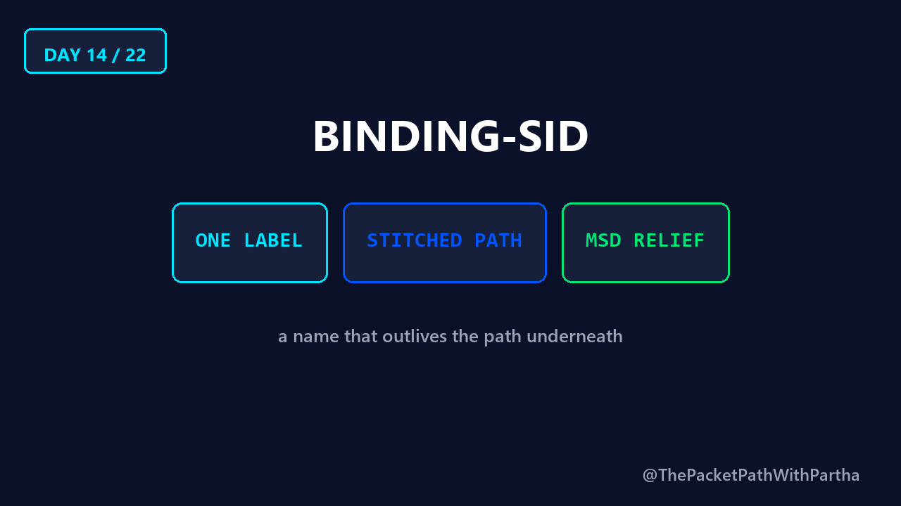

---

### Day 15 — On-Demand Next Hop
*A policy that builds itself*

Days 11-14 built the full SR-TE toolkit, but configuring a policy per destination
does not scale past a handful of PEs. On-Demand Next Hop is the automation that
makes it production-grade.

- **The reframe.** Every policy is (head-end, colour, end-point). The head-end
  and end-point already come from where traffic is and where it is going; only
  the colour is new information. So a BGP route carrying that colour triggers the
  policy automatically, at the end-point the route names.
- **How it works.** A BGP route arrives with a colour community, the head-end
  checks its ODN templates, and a match instantiates a real SR Policy with the
  route's own next-hop as the end-point. The route then resolves over it.
- **One template per colour.** A template reuses Day 13's objective - ODN only
  decides *when* an existing mechanism applies.
- **SLA to colour.** Gold (real-time voice/video) maps to a min-delay colour,
  Silver (business VPN) to a colour that avoids a region, Bronze to no template
  and ordinary ECMP. The colour is where business intent meets network config.

▶ [Watch on YouTube](https://youtu.be/_pI-8Pwltwk) · 13:16 ·
[`videos/Day15_On_Demand_Next_Hop.mp4`](videos/Day15_On_Demand_Next_Hop.mp4)

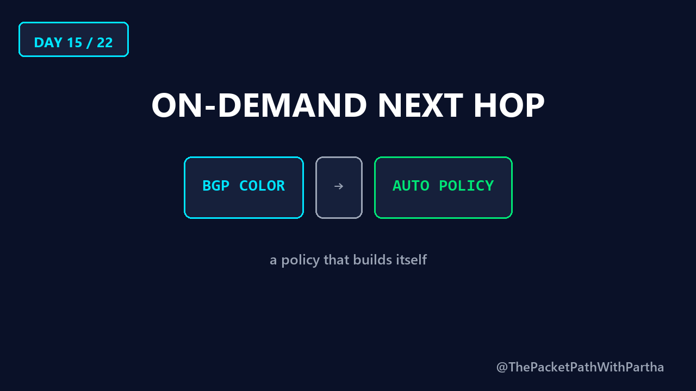

---

## Technical papers

Longer-form write-ups that go with the series.

### [SR-MPLS MTU: Packet Size, Label Depth, and Path Design](articles/SR-MPLS_MTU_Technical_Paper_Enam_Ahmed.pdf)
*How to size every link for reliable, scalable Segment Routing*

A link can pass ordinary 1,500-byte IP traffic and still fail once SR-MPLS or a
service adds labels. This paper separates the different meanings of MTU, shows
how to count label overhead (four bytes per entry, counted per link), and keeps
two checks apart that are often confused: **byte size** and **label-stack depth**
(MSD). It ends with a repeatable rollout method, a safe test procedure and the
common design mistakes.

- What "MTU" actually counts: IP MTU, MPLS packet size, L2 frame size, path MTU
- A worked byte budget for 2-, 5- and 7-label stacks
- Why the backup path can be the one that drops traffic
- IPv4 Path MTU Discovery and IPv6 Packet Too Big
- A seven-step design and rollout method, and how to probe it safely

📄 [Read the PDF](articles/SR-MPLS_MTU_Technical_Paper_Enam_Ahmed.pdf)

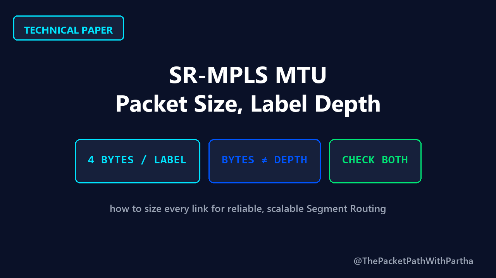

---

## Hands-on labs

Standalone labs that go with the series — full device configs, verification
output, diagrams and write-ups.

### [L3VPN Over SR-MPLS](labs/l3vpn-over-sr-mpls)

Four-router IOS XRv lab proving MPLS L3VPN (VRF/RD/RT/VPNv4 BGP) running on
an SR-MPLS transport instead of LDP — two PEs, two VRFs, full running-configs,
and a traceroute-verified packet walk through the transport and VPN labels.

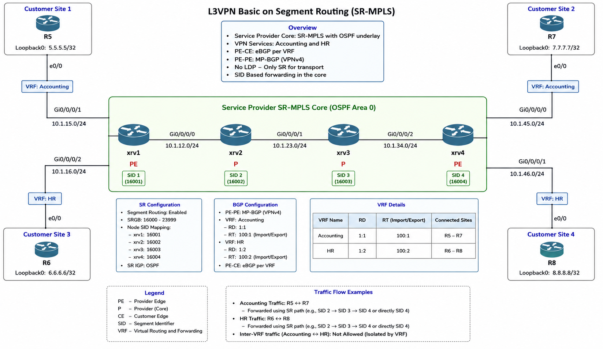

---

## Coming up

| Day | Topic |
|---|---|
| 16–22 | TI-LFA, L3VPN/EVPN, troubleshooting |

New lesson every day.

## Who this is for

Network engineers, NOC and IP transport professionals, CCNP and CCIE Service
Provider candidates, and anyone building scalable, programmable networks.

## Format

Every episode is 1080p30, self-narrated, and follows the same structure: learning
outcomes up front, the problem, a practical analogy, an architecture walkthrough,
the benefits and trade-offs, and a three-question knowledge check to close.
